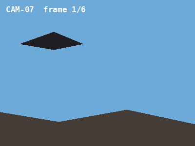
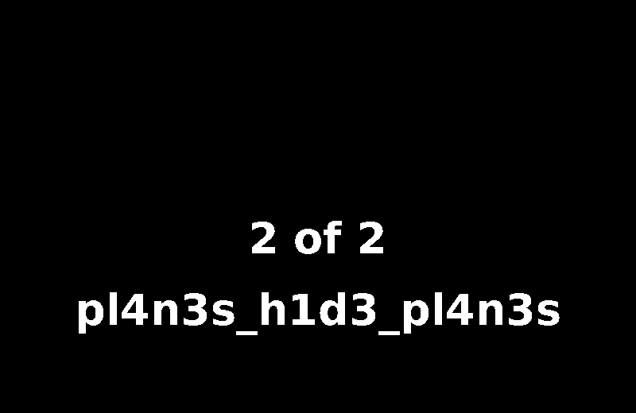

## Overview

Frame of Reference chains four steps across two files. The delays between the frames of a GIF are ASCII codes that spell a word. That word, plus the camera number printed on each frame, is the passphrase for a ZIP attached to a PNG. The ZIP holds half the flag, and the other half is painted into one bit plane of the same PNG. The challenge covers GIF metadata, appended archives, and bit-plane analysis, with every step confirming the one before it.

## Challenge Description

The written prompt for this challenge was not saved with the event files. Players received two files:

- `nest_cam.gif`: a six-frame animation from a bird nest camera
- `field_notes.png`: a page of handwritten-style field notes

## Recon

Start with what each file shows. Every GIF frame is stamped `CAM-07`:



The field notes page is a short log from a falcon roost:


Three lines matter later: "Tiercel returned twice with prey", "Camera clock seems off again - check the log", and "tiercel wears the blue one".

Now the metadata. The GIF has a comment block. Read it with [exiftool](/tools/exiftool) (`-b` prints the raw value):

```console
$ exiftool -b -Comment nest_cam.gif
... | CAM-07 firmware log: frame interval jitter detected (units: 10 ms). Operator note: the jitter
is not a bug. The sealed archive attached to field_notes.png uses a passphrase made of the word
the camera is trying to say (lowercase) followed by this unit's two-digit camera number.
```

The comment starts with a notice to AI tools, which is not part of the puzzle. The rest says three things: the frame timing carries a word, the PNG has an archive attached, and the passphrase is that word in lowercase plus the camera number.

## Walkthrough

### 1. Decode the frame delays

GIF frames store their delay in hundredths of a second. [ImageMagick](/tools/imagemagick) prints them with the `%T` format:

```console
$ identify -format "%T " nest_cam.gif
84 69 82 67 69 76
```

Uneven delays in that range look like ASCII codes (65 to 90 are capital letters). Convert them with an ASCII table, `man ascii`, or CyberChef's **From Decimal**:

| Frame | 1 | 2 | 3 | 4 | 5 | 6 |
| --- | --- | --- | --- | --- | --- | --- |
| Delay (10 ms) | 84 | 69 | 82 | 67 | 69 | 76 |
| Letter | T | E | R | C | E | L |

The word is **TERCEL**, another spelling of the "tiercel" in the field notes. Both mean a male falcon.

### 2. Build the passphrase

The word in lowercase plus the two-digit camera number from the frame overlay: **`tercel07`**. Variants such as `tercel`, `TERCEL`, and `tercel7` fail.

### 3. Open the archive attached to the PNG

[binwalk](/tools/binwalk) shows a ZIP after the image data:

```console
$ binwalk field_notes.png
DECIMAL                            HEXADECIMAL                        DESCRIPTION
---------------------------------------------------------------------------------------
0                                  0x0                                PNG image, total size: 924291 bytes
924291                             0xE1A83                            ZIP archive, file count: 1, total size: 353 bytes
```

```console
$ unzip -P tercel07 field_notes.png
Archive:  field_notes.png
warning [field_notes.png]:  924291 extra bytes at beginning or within zipfile
  (attempting to process anyway)
  inflating: fragment1.txt
$ cat fragment1.txt
FRAGMENT 1 of 2: fr4m3_t1m1ng_
Fragment 2 is painted, not written - it lives in a quieter plane of the page this archive was attached to.
Join the fragments in order, then wrap in BOO{ }.
```

### 4. Find fragment 2 in the bit planes

Each color channel of an image is made of eight bit planes. The low planes change each pixel's value by only 1 or 2 out of 255, so text drawn there is invisible in the normal image. The field notes said the tiercel "wears the blue one", which points at the blue channel.

In [Stegsolve](/tools/stegsolve), open `field_notes.png` and click through the planes with the arrow buttons until you reach **Blue plane 1**:



Other ways to get the same plane: `stegoveritas field_notes.png` writes every plane out as an image, and a few lines of Python with Pillow do it directly:

```python
from PIL import Image

blue = Image.open("field_notes.png").convert("RGB").getchannel("B")
blue.point(lambda v: 255 if (v >> 1) & 1 else 0).save("blue_plane_1.png")
```

### 5. Assemble the flag

| Fragment | Where | Value |
| --- | --- | --- |
| 1 of 2 | `fragment1.txt` in the ZIP | `fr4m3_t1m1ng_` |
| 2 of 2 | Blue plane 1 | `pl4n3s_h1d3_pl4n3s` |

Join them inside `BOO{ }`.

## Solution

```console
$ identify -format "%T " nest_cam.gif
84 69 82 67 69 76
$ unzip -P tercel07 field_notes.png
$ cat fragment1.txt
FRAGMENT 1 of 2: fr4m3_t1m1ng_
$ python3 -c 'from PIL import Image; Image.open("field_notes.png").convert("RGB").getchannel("B").point(lambda v: 255 if (v >> 1) & 1 else 0).save("blue_plane_1.png")'
```

Open `blue_plane_1.png` to read `pl4n3s_h1d3_pl4n3s`, then combine the two fragments.

## Flag

```text
BOO{fr4m3_t1m1ng_pl4n3s_h1d3_pl4n3s}
```

## Takeaways

- Read every metadata field. The GIF comment explained what the timing meant and how the passphrase was built.
- Numbers between 65 and 122 that look out of place are often ASCII. Try converting them.
- When a hint mentions a "quieter" layer, step through the bit planes of each color channel one at a time.
- Work in order. Each stage produced readable output (the word TERCEL, the word FRAGMENT, legible text in the plane), so you always knew you were on track.
- The archive used legacy ZipCrypto, which a determined player could attack with a cracking tool. Real data that needs protection belongs in AES-encrypted archives with long passphrases.

## References

- [ImageMagick: format and print image properties (%T is the frame delay)](https://imagemagick.org/script/escape.php)
- [Stegsolve releases on GitHub](https://github.com/Giotino/stegsolve/releases)
- [Wikipedia: Bit plane](https://en.wikipedia.org/wiki/Bit_plane)
