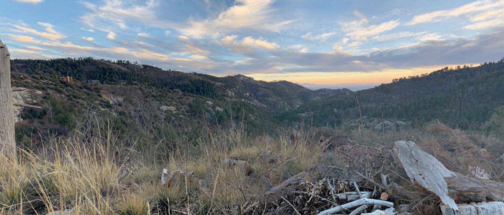
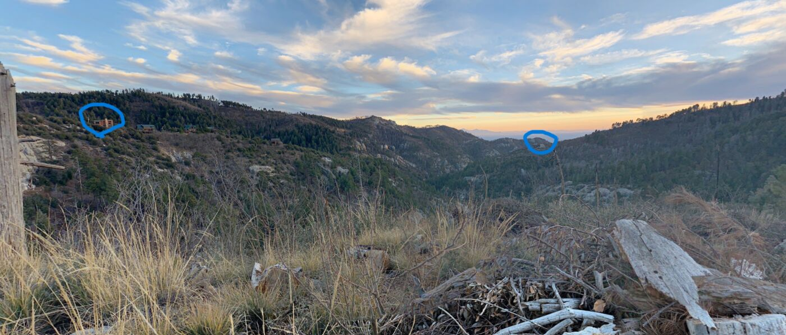
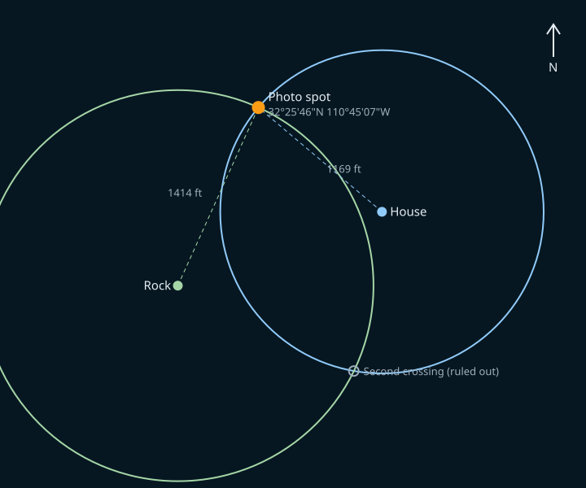

## Overview

Geoguessing gives you a sunset photo from the Instagram account found in [Socials](/challenges/socials) and asks for the name of the photographer. The hints give the coordinates of two landmarks visible in the photo and the distance from each one to the camera. Two circles drawn around the landmarks cross at two points, and the view in the photo decides which one is right. A Google Maps photosphere at that spot names its photographer. The challenge teaches geolocation by trilateration, the same idea GPS uses.

## Challenge Description

> Find the location of the photo from the instagram account in the last step using only what you have here. Submit the photographer's last name as the flag (BOO{lastName}).

Provided files: `challenge_image.png` (the photo) and `hint_image.png` (the same photo with the two landmarks circled). The event hints:

> 1. Use the image below and these two points:
>    - House: 32°25'38.78"N 110°44'56.14"W
>    - Rock: 32°25'33.51"N 110°45'13.39"W
> 2. The Distance from:
>    - The rock to the photo is 1414 ft
>    - The house to the photo is 1169 ft
> 3. Try using Google Earth, specifically the circle feature



## Recon

The photo is taken near sunset from a grassy slope. The hills are covered in pine trees, with bare granite showing in places and a few cabins on the slope to the left. Pines on rocky granite above a hazy lowland point toward one of the "sky island" mountain ranges of southern Arizona, and both sets of hint coordinates are about 19 miles northeast of downtown Tucson, in the Santa Catalina Mountains (Mount Lemmon).

The hint image marks the two landmarks:



The house is on the left side of the frame, and the rock is just right of center.

## Walkthrough

### 1. Mark the two landmarks

In [Google Earth Pro](/tools/google-earth), use **Add > Placemark** and paste each set of coordinates, or type them into the search box:

- House: `32°25'38.78"N 110°44'56.14"W`
- Rock: `32°25'33.51"N 110°45'13.39"W`

The two points are about 1,570 feet apart, with the house to the east of the rock.

### 2. Draw the two circles

Open **Tools > Ruler** and choose the **Circle** tab. Set the unit to feet, click on the house, and drag out a circle with a radius of **1169 ft**. Save it, then draw a second circle with a radius of **1414 ft** around the rock.

Every point on the first circle is 1169 feet from the house, and every point on the second is 1414 feet from the rock. The camera has to be on both circles at once, so it is at one of the points where they cross.

### 3. Pick the right crossing

Two circles cross at two points:



| Point | Coordinates | House is | Rock is |
| --- | --- | --- | --- |
| North | 32°25'46"N 110°45'07"W | to the southeast | to the south-southwest |
| South | 32°25'27"N 110°44'58"W | to the north | to the west-northwest |

From the northern point, a camera facing roughly south has the house on the left and the rock right of center, with the western sky (the sunset) on the right. That matches the photo. From the southern point the house would be on the right. The answer is the northern crossing, about **32.4295, -110.7518**, on the Sunset Trail at Soldier Camp, roughly a mile southeast of Summerhaven.

### 4. Find the photosphere

Open the spot in Google Maps and drag the Street View figure (the pegman) onto the map. Blue dots are user-uploaded 360-degree photos (photospheres). According to the challenge author's solution, a photosphere at the crossing point shows this view, and the name of the person who uploaded it appears in the top left corner of the viewer. The photographer's last name is **Restucci**.

## Solution

The crossing points can also be computed instead of drawn. This script converts both landmarks to feet on a flat local map (accurate enough over a few thousand feet) and intersects the circles:

```python
import math

def dms(d, m, s):
    return d + m / 60 + s / 3600

house = (dms(32, 25, 38.78), -dms(110, 44, 56.14))
rock = (dms(32, 25, 33.51), -dms(110, 45, 13.39))
r_house, r_rock = 1169, 1414            # feet, from hint 2

R = 6371008.8 * 3.28084                  # Earth radius in feet
lat0 = math.radians((house[0] + rock[0]) / 2)
to_xy = lambda p: (math.radians(p[1]) * R * math.cos(lat0), math.radians(p[0]) * R)
to_ll = lambda x, y: (math.degrees(y / R), math.degrees(x / (R * math.cos(lat0))))

(x1, y1), (x2, y2) = to_xy(house), to_xy(rock)
d = math.hypot(x2 - x1, y2 - y1)
a = (r_house**2 - r_rock**2 + d**2) / (2 * d)
h = math.sqrt(r_house**2 - a**2)
xm, ym = x1 + a * (x2 - x1) / d, y1 + a * (y2 - y1) / d
for s in (1, -1):
    lat, lon = to_ll(xm + s * h * (y2 - y1) / d, ym - s * h * (x2 - x1) / d)
    print(f"{lat:.6f}, {lon:.6f}")
```

```console
$ python3 circles.py
32.429507, -110.751828
32.424283, -110.749588
```

The first point is the one that matches the photo. The photosphere there gives the photographer's last name.

## Flag

```text
BOO{Restucci}
```

## Takeaways

- Two known points and two distances narrow a location down to two candidates. A third distance, or what is visible in the photo, picks between them.
- Use the picture to check the math. Which landmark is on the left, where the sun is setting, and what is in front of the camera all rule out wrong answers.
- Vegetation, rock, and terrain narrow a region quickly. Pines on granite above a desert basin is a very specific kind of place.
- Photospheres on Google Maps carry the uploader's name. Anything you post publicly with a location attached can be traced back to the spot and to you.

## References

- [Google Earth Pro: measure distances and areas](https://support.google.com/earth/answer/148110)
- [Wikipedia: Trilateration](https://en.wikipedia.org/wiki/Trilateration)
- [Wikipedia: Madrean Sky Islands](https://en.wikipedia.org/wiki/Madrean_Sky_Islands)
