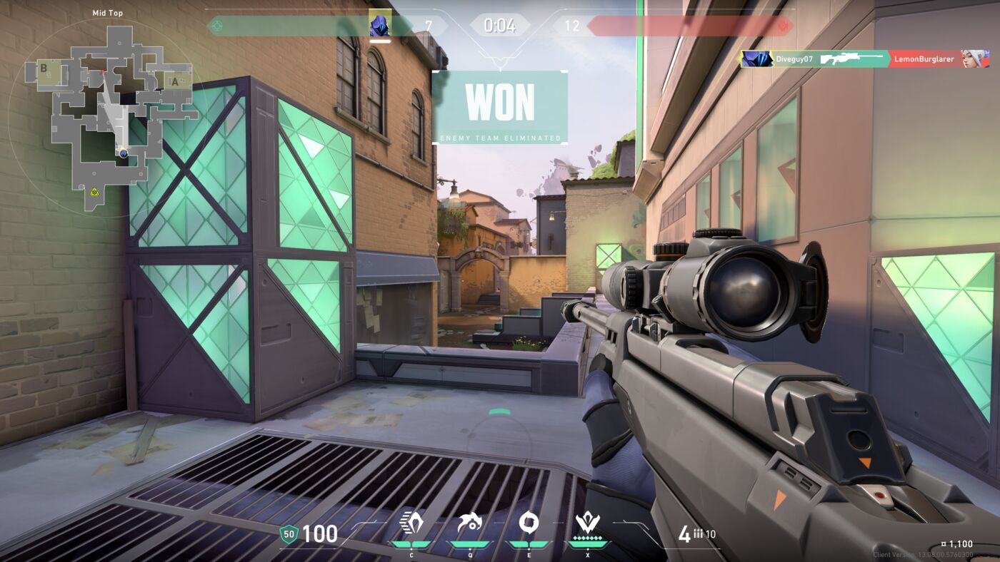
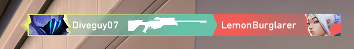

## Overview

Socials starts from a Valorant match screenshot and asks you to find a player's Instagram. The only identifier in the picture is an in-game username, so the work is pivoting: from the username to an X (Twitter) account, from that account's posts to an Instagram account, and from the Instagram bio to a Base64 string that decodes to the flag. The challenge teaches username searches and following one account to the next, the core loop of social media OSINT.

## Challenge Description

> This guy was really nice in my Valorant game today. He told me to find his insta and reach out.

Provided file: `valorant_screenshot.png`, a full-screen capture from the end of a round.



The event hints were "Try using a reverse username search" and "What's that in his bio?"

## Recon

The screenshot shows a round that just ended ("WON, ENEMY TEAM ELIMINATED"), a minimap, and the kill feed in the top right. The kill feed is the only place with player names:



In Valorant's kill feed, the player on the left got the kill and the player on the right was eliminated. `Diveguy07` is on the screenshot owner's team (the same color as the score on the left), and **`LemonBurglarer`** is the player who was eliminated, the "guy" from the description. That unusual username is the lead.

## Walkthrough

### 1. Search for the username across sites

People reuse usernames, so the same handle often exists on several platforms. A username search tool checks hundreds of sites at once:

- [Sherlock](/tools/sherlock) from the command line: `sherlock LemonBurglarer`
- WhatsMyName in the browser: https://whatsmyname.app/

According to the challenge author's solution, the search turns up an **X (Twitter) account** for this username.

### 2. Read the X account

Check the bio and the posts. The posts point to the user's Instagram account. This is the pivot: a username search found one account, and that account's own content leads to the next.

### 3. Read the Instagram bio

The Instagram bio contains a string that does not look like words, made of letters, digits, and possibly `=` at the end. That is the "What's that in his bio?" hint.

### 4. Decode it

Paste the string into [CyberChef](/tools/cyberchef) with **From Base64**, or use the command line:

```console
$ echo '<string from the bio>' | base64 -d
BOO{Sup3r_s3cr3t_1nst4}
```

A quick way to spot an encoded flag: `BOO{` in Base64 starts with `Qk9Pe`. The full flag encodes to `Qk9Pe1N1cDNyX3MzY3IzdF8xbnN0NH0=`.

## Solution

1. Read the eliminated player's name from the kill feed: `LemonBurglarer`.
2. Search the username across sites (Sherlock or WhatsMyName) and open the X account.
3. Follow the X posts to the Instagram account.
4. Base64-decode the string in the Instagram bio.

```console
$ sherlock LemonBurglarer
$ echo 'Qk9Pe1N1cDNyX3MzY3IzdF8xbnN0NH0=' | base64 -d
BOO{Sup3r_s3cr3t_1nst4}
```

## Flag

```text
BOO{Sup3r_s3cr3t_1nst4}
```

## Takeaways

- Read screenshots closely. Kill feeds, scoreboards, chat boxes, and window titles all leak usernames.
- A distinctive username is a strong lead, because people reuse handles across platforms. Username search tools check hundreds of sites in one go.
- Pivot from account to account. Bios, posts, and links on one profile often name the next.
- Text that looks random in a bio is worth decoding. `Qk9Pe` at the start of a string means `BOO{`.
- For your own privacy, use different usernames for gaming and for personal social accounts, and do not link accounts to each other unless you want them connected.

## References

- [Sherlock on GitHub](https://github.com/sherlock-project/sherlock)
- [WhatsMyName](https://whatsmyname.app/)
- [OSINT Framework](https://osintframework.com/)
