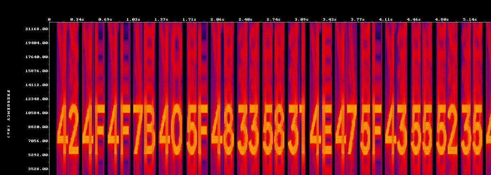

## Overview

Spooky Signals is a six-second WAV file with a message drawn into its frequencies. Listening gets you nowhere. Viewing the audio as a spectrogram shows a row of hex codes, and converting the hex to ASCII gives the flag. The challenge teaches the spectrogram view, one of the first things to check on any audio file in a CTF, plus reading hex as text.

## Challenge Description

The written prompt for this challenge was not saved with the event files. Players received one file:

- `spooky_signals.wav`: 6 seconds, mono, 44.1 kHz

Everything needed to solve it is inside that file.

## Recon

Start with what the file is and what metadata it carries:

```console
$ exiftool spooky_signals.wav | grep -E 'Duration|Sample Rate|Num Channels'
Num Channels                    : 1
Sample Rate                     : 44100
Duration                        : 6.00 s
```

Listening to the clip does not reveal a message, and the metadata has no hint. When audio carries nothing you can hear in a CTF, the next step is to look at it instead.

## Walkthrough

### 1. Open a spectrogram

A spectrogram plots time left to right, frequency bottom to top, and loudness as brightness. Text drawn into the frequencies shows up as readable shapes.

- **[Audacity](/tools/audacity):** open the file, click the track name dropdown on the left of the track, and choose **Spectrogram**.
- **Sonic Visualiser:** open the file and use **Layer > Add Spectrogram**.
- **Command line:** `ffmpeg -i spooky_signals.wav -lavfi showspectrumpic=s=1400x500 spectrogram.png` writes the spectrogram to an image.



### 2. Read the hex codes

Nineteen two-digit hex values are drawn across the 6 seconds:

```text
42 4F 4F 7B 40 5F 48 33 58 31 4E 47 5F 43 55 52 35 45 7D
```

Each pair is one byte, so the message is 19 characters long. The first four, `42 4F 4F 7B`, are `B`, `O`, `O`, `{`, the flag format in hex.

### 3. Convert the hex to text

Paste the hex into [CyberChef](/tools/cyberchef) with the **From Hex** operation, or use Python:

```console
$ python3 -c 'print(bytes.fromhex("42 4F 4F 7B 40 5F 48 33 58 31 4E 47 5F 43 55 52 35 45 7D").decode())'
BOO{@_H3X1NG_CUR5E}
```

| Hex | 42 | 4F | 4F | 7B | 40 | 5F | 48 | 33 | 58 | 31 |
| --- | --- | --- | --- | --- | --- | --- | --- | --- | --- | --- |
| Char | B | O | O | { | @ | _ | H | 3 | X | 1 |

| Hex | 4E | 47 | 5F | 43 | 55 | 52 | 35 | 45 | 7D |
| --- | --- | --- | --- | --- | --- | --- | --- | --- | --- |
| Char | N | G | _ | C | U | R | 5 | E | } |

## Solution

Render the spectrogram, read the 19 hex pairs off the image, and convert them:

```console
$ ffmpeg -i spooky_signals.wav -lavfi showspectrumpic=s=1400x500 spectrogram.png
$ python3 -c 'print(bytes.fromhex("424F4F7B405F483358314E475F43555235457D").decode())'
BOO{@_H3X1NG_CUR5E}
```

Reading the pairs off the picture is the only manual step.

## Flag

```text
BOO{@_H3X1NG_CUR5E}
```

## Takeaways

- Audio is not only for listening. When a file sounds like noise or the challenge hints at hidden signals, open the spectrogram first.
- Learn to recognize the flag prefix in common encodings. `42 4F 4F 7B` is `BOO{` in hex.
- Use a tool such as CyberChef for conversions instead of looking up each byte by hand.
- Each tool draws spectrograms a little differently. If the text looks smeared, raise the window size or the maximum frequency in the spectrogram settings.

## References

- [Audacity manual: Spectrogram view](https://manual.audacityteam.org/man/spectrogram_view.html)
- [FFmpeg filters: showspectrumpic](https://ffmpeg.org/ffmpeg-filters.html#showspectrumpic)
- [Wikipedia: Spectrogram](https://en.wikipedia.org/wiki/Spectrogram)
