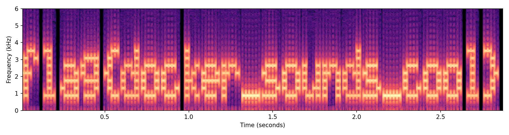

## Overview

Weird Sounds is a short WAV file made of tones that sound like random beeps. Viewed as a spectrogram, the tones line up into pixel letters that spell the flag. The challenge teaches the spectrogram view in Audacity, the first check to make on any audio file that sounds generated instead of recorded.

## Challenge Description

The written prompt for this challenge was not saved with the meeting files. Players received one file:

- `weird_sounds.wav`: 2.88 seconds, mono, 44.1 kHz

## Recon

```console
$ file weird_sounds.wav
weird_sounds.wav: RIFF (little-endian) data, WAVE audio, Microsoft PCM, 16 bit, mono 44100 Hz
```

Playing it gives about three seconds of buzzing and beeping. It does not sound like music or speech, which hints that the audio was generated on purpose.

WAV is one of the formats [Steghide](/tools/steghide) supports, so it is fair to rule that out first. With an empty passphrase, Steghide finds nothing:

```console
$ steghide info weird_sounds.wav -p ""
"weird_sounds.wav":
  format: wave audio, PCM encoding
  capacity: 7.8 KB
steghide: could not extract any data with that passphrase!
```

## Walkthrough

### 1. Open the file in Audacity

[Audacity](/tools/audacity) runs on your own computer (not in the Docker container). Use **File > Open** and choose `weird_sounds.wav`.

### 2. Switch to the spectrogram view

Click the track name on the left side of the waveform and choose **Spectrogram** from the menu.

### 3. Read the flag

The flag is written across the track in pixel letters. If it looks small, drag the bottom edge of the track down to make it taller, or zoom in on the timeline. The letters sit between roughly 900 Hz and 3,600 Hz, so they show up in Audacity's default view.



## Solution

Open the file in a spectrogram viewer and read the text. Without a GUI, ffmpeg writes a spectrogram image you can open with any image viewer:

```bash
ffmpeg -i weird_sounds.wav -lavfi showspectrumpic=s=1400x500:stop=5000 spectrogram.png
```

`stop=5000` limits the view to 0 to 5,000 Hz so the letters fill the image.

## Flag

```text
flag{docker_sounds_cool}
```

## Takeaways

- A waveform shows loudness over time. A spectrogram shows which frequencies are present over time: time left to right, frequency bottom to top, brightness for loudness.
- To draw text, treat the spectrogram like a grid. Each row is one pure tone (here about 450 Hz apart, from 900 Hz to 3,600 Hz), and playing that tone during a slice of time lights up one pixel.
- Any audio challenge that sounds like noise, beeps, or static is worth checking in spectrogram view.
- If nothing appears, raise the maximum frequency in Audacity's spectrogram settings. Messages are sometimes drawn near the top of the audible range.

## References

- [Audacity manual: Spectrogram view](https://manual.audacityteam.org/man/spectrogram_view.html)
- [Wikipedia: Spectrogram](https://en.wikipedia.org/wiki/Spectrogram)
