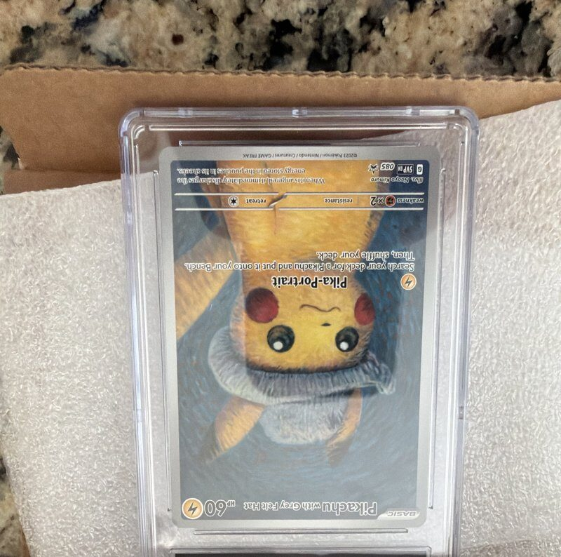
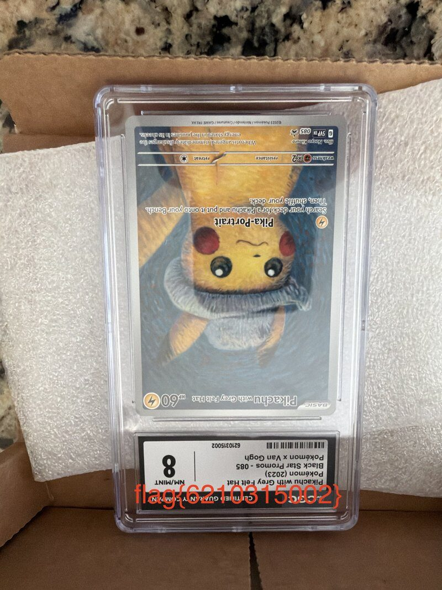

## Overview

What's My Label is a phone photo of a graded trading card in its case, with the grading label cut off at the bottom. No pixels were deleted: the PNG header just tells viewers the image is 3000 rows tall instead of 4032. The challenge teaches the layout of a PNG header, comparing the header against leftover EXIF data, and recalculating a CRC after editing bytes.

## Challenge Description

The written prompt for this challenge was not saved with the meeting files. Players received one file:

- `whats_my_label.png`: a 13 MB PNG photo



The file name asks about a label, and the picture stops right where the label should be. That points at the bottom of the image, not at something hidden inside it.

## Recon

```console
$ file whats_my_label.png
whats_my_label.png: PNG image data, 3024 x 3000, 8-bit/color RGBA, non-interlaced
```

A width of 3024 is a standard phone photo width, and phone photos at that width are 4032 pixels tall. This one claims 3000.

## Walkthrough

### 1. Read the header

```console
$ xxd whats_my_label.png | head -2
00000000: 8950 4e47 0d0a 1a0a 0000 000d 4948 4452  .PNG........IHDR
00000010: 0000 0bd0 0000 0bb8 0806 0000 00b3 25b1  ..............%.
```

A PNG starts with an 8-byte signature, then the `IHDR` chunk. Counting from 0:

| Bytes | Value | Meaning |
| --- | --- | --- |
| 16 to 19 | `0000 0bd0` | Width: 3024 |
| 20 to 23 | `0000 0bb8` | Height: 3000 |
| 24 to 28 | `08 06 00 00 00` | Bit depth and color format |
| 29 to 32 | `b3 25 b1 ..` | CRC of bytes 12 to 28 |

### 2. Find the real height

The photo still carries the camera's metadata. [ExifTool](/tools/exiftool) shows both heights side by side:

```console
$ exiftool whats_my_label.png | grep -iE 'image (width|height)'
Image Width                     : 3024
Image Height                    : 3000
Exif Image Width                : 3024
Exif Image Height               : 4032
```

`Image Height` comes from the PNG header. `Exif Image Height` is what the camera recorded: 4032. About a thousand rows are being hidden. Without exiftool, [`strings`](/tools/strings) finds the same value in the XMP metadata:

```console
$ strings whats_my_label.png | grep PixelYDimension
         <exif:PixelYDimension>4032</exif:PixelYDimension>
```

### 3. Change the height and fix the CRC

The height needs to become 4032, which is `00000fc0` in hex. PNG stores a CRC (a checksum) right after the header data, and many viewers refuse a file whose header does not match it. Whoever made the challenge updated the CRC after shrinking the height, so the file looked normal. Changing the height back means recalculating the CRC too.

## Solution

`fix.py` from the challenge files:

```python
import struct
import zlib

data = bytearray(open("whats_my_label.png", "rb").read())

# Bytes 20-23 hold the height. Write the real height there.
data[20:24] = struct.pack(">I", 4032)

# Bytes 29-32 hold the CRC of bytes 12-28 (the chunk type and data).
data[29:33] = struct.pack(">I", zlib.crc32(data[12:29]))

open("fixed.png", "wb").write(data)
print("Saved fixed.png")
```

```console
$ python3 fix.py
Saved fixed.png
$ file fixed.png
fixed.png: PNG image data, 3024 x 4032, 8-bit/color RGBA, non-interlaced
```

Open `fixed.png`. The bottom of the image now shows the grading label with the flag written across it:



You can also make the edit by hand in a [hex editor](/tools/hex-editors) such as Hex Fiend on macOS or HxD on Windows, then fix the CRC with a script or open the file in a viewer that ignores CRCs.

## Flag

```text
flag{6210315002}
```

## Takeaways

- If an image looks cropped in a strange place, check the dimensions in its header.
- A viewer decodes exactly as many rows as the header says and throws away the rest. Lowering the height hides rows without deleting them.
- Metadata can tell you what a file used to look like. Compare the header against EXIF data whenever something seems off.
- With no metadata to help, try a larger height. Too large usually shows the hidden rows plus some garbage or a decoding error at the bottom.
- Any edit to a PNG header needs a new CRC, or strict tools reject the file.

## References

- [PNG specification: IHDR chunk](https://www.w3.org/TR/png-3/#11IHDR)
- [Python documentation: zlib.crc32](https://docs.python.org/3/library/zlib.html#zlib.crc32)
